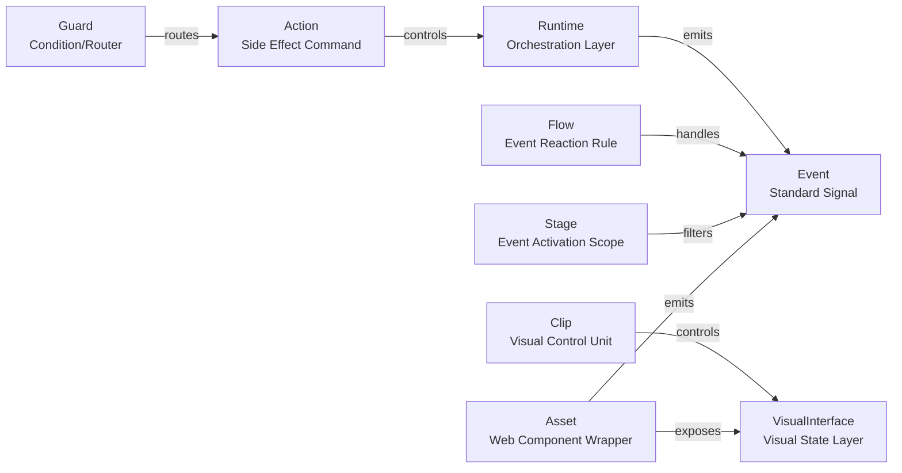
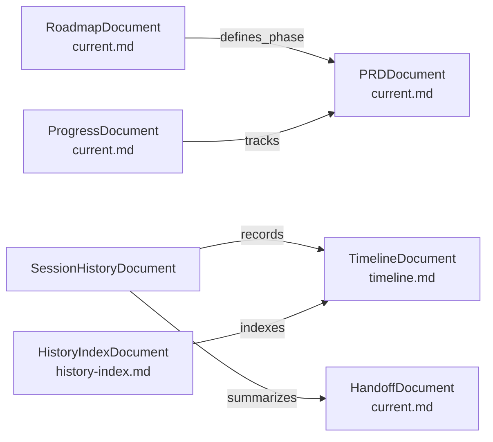

# Architecture Definition Operating System

> 이 시스템은 아키텍처 설계 결정을 YAML DSL로 정의하고, Governance 메타데이터로 추적하며, 검증 규칙으로 무결성을 보장하는 **문서 기반 아키텍처 운영체제**이다.

## Core System

Core System은 기존 Web 구현을 Web Component Asset으로 감싸고,
Asset이 노출한 Visual Interface를 Clip으로 제어하며,
Event → Flow → Action → Event 루프를 통해
Story와 Interaction을 orchestration하는 **Event-driven Visual Runtime**이다.

```text
Asset emits Event.
Stage filters Event.
Flow handles Event.
Guard routes Action.
Action controls Runtime.
Clip controls Visual Interface.
Runtime emits Event again.
```

---

## Directory Structure

```text
architecture/
├─ README.md                          ← 이 파일 (아키텍처 가이드 및 철학 SSOT)
├─ model/
│  └─ archi-adr.yaml                  ← SSOT: 전체 모델 정의
├─ docs/
│  ├─ architecture/                   ← 아키텍처 사양 문서
│  ├─ rules/                          ← 규칙 문서
│  ├─ adr/                            ← Architecture Decision Records
│  ├─ business/                       ← BusinessLogicDocument
│  ├─ metadata/                       ← MetadataDefinitionDocument
│  └─ governance/                     ← Governance 메타데이터
│     ├─ roadmap/current.md           ← 로드맵 (HEAD)
│     ├─ prd/current.md               ← PRD (HEAD)
│     ├─ progress/current.md          ← 진행 상태 (HEAD)
│     ├─ handoff/current.md           ← 핸드오프 (HEAD)
│     ├─ sessions/                    ← 세션 기록 (sessions/YYYY/MM/)
│     ├─ timeline.md                  ← 시간순 원본 포인터
│     └─ history-index.md             ← 압축 히스토리 색인
├─ validation/
│  ├─ schema.json                     ← JSON Schema 2020-12
│  └─ semantic-rules.yaml             ← 의미적 검증 규칙
└─ generated/
   ├─ mermaid/                        ← Mermaid 다이어그램 출력 (.mmd)
   ├─ reports/                        ← 보고서 출력
   └─ exports/                        ← 내보내기 출력
```

---

## Knowledge & Documentation Architecture

아키텍처 문서화의 규모가 대폭 확장될 때 발생하는 복잡도를 통제하고 지식 누락을 방지하기 위해 다음 두 가지 아키텍처 거버넌스(`definition-catalog`) 핵심 철학을 준수합니다.

### 1. E/C/I/S + L/P 책임 분리
모든 사양 문서는 혼합 책임을 배격하며, 다음 5가지 범주 중 하나에 부합하도록 엄격히 경계를 격리하여 분할 관리합니다.
* **Entry / Identity (E)**: 안정적인 고유 ID, 유한한 상태 구조만을 정의합니다. 행위나 동작 로직을 직접 서술하지 않습니다.
* **Component (C)**: 데이터 구조와 상태의 스키마 명세만 담당하는 Data-only 리드 모델입니다.
* **Interface / DSL (I)**: API/CLI/이벤트/규칙 간의 소비 및 통신 계약을 명시합니다.
* **System (S)**: 독립적인 런타임 행위 및 소스/테스트의 경계 분리를 보장하는 물리적 시스템 단위입니다.
* **Layout / Pack (L/P)**: 여러 시스템과 인터페이스들의 조망과 배치를 담당하며, 행위를 직접 소유하지 않고 오직 관계도 구성에만 집중합니다.

### 2. DefLevel 계층 모델 및 Contains 누락 검사
문서 간에 고아(Dangling) 상태가 발생하지 않고 체계적으로 계층화되도록 3단계 메타데이터를 사용하여 contains 관계망 그래프를 형성합니다.
1. **`group`**: 여러 사양서가 묶여서 소통되어야 하는 사유와 거시적 아웃라인을 정의합니다. (최소 1개 이상의 자식을 포함하는 `contains` 관계가 필수적이며, 검증 룰 `SR-015`에 의해 강제됩니다.)
2. **`module`**: 구체적인 하나의 아키텍처 개념을 서술하며 하위 구성 요소 참조를 유기적으로 선언합니다. (최소 1개 이상의 자식을 포함하는 `contains` 관계가 필수적이며, 검증 룰 `SR-015`에 의해 강제됩니다.)
3. **`leaf`**: 종단에서 구체적인 스펙을 명세하는 문서입니다. 하위 자식을 갖지 않으며, 하나의 leaf 문서가 150줄을 초과해 복잡도가 비대해질 경우 검증 룰 `SR-016`에 의해 분할 경고(Warning)가 발생합니다.

---

## Naming Rules

| 원칙 | 표현 방식 |
|------|----------|
| 구조 | 폴더 계층 |
| 시간 | 파일명 suffix (`-YYYY-MM-DD`) |
| 현재 활성 상태 | `current.md` (HEAD pointer) |
| 과거 스냅샷 | 날짜 파일 (immutable snapshot) |

```text
roadmap-2026-05-26.md
dsl-prd-2026-05-26.md
progress-2026-05-26.md
handoff-2026-05-26.md
session-2026-05-26-001.md
```

---

## CLI Automation & Command Ecosystem

이 프로젝트는 아키텍처 거버넌스를 완벽히 자동화하기 위해 전용 **`archi` CLI** 도구를 사용합니다.

> **참고 — `vendor/archi-adr`와의 관계**  
> [archi-adr](https://github.com/mineclover/archi-adr)는 qa-sdk **외부에서 별도로 시도 중인** 아키텍처 설계 라이브러리로, `vendor/archi-adr` submodule로만 참조한다.  
> 이 디렉터리의 `archi` CLI(`packages/archi`)·`model/archi-adr.yaml`과는 `file:`/`workspace` 연동 없이 독립 운영한다. 상세: [`vendor/README.md`](../vendor/README.md).

```text
archi
├── init                  # 템플릿 기반의 architecture/ 폴더 구조 초기화
├── new <doc-type>        # 명명 규칙을 적용한 불변 스냅샷 문서 생성 (NNN 자동 시퀀스 및 current.md 갱신)
├── validate              # frontmatter 구조, 모델 무결성, 12대 의미적 규칙 정밀 검사
├── timeline              # 모든 세션 스냅샷을 수집하여 시간순으로 timeline.md 자동 인덱싱
├── render                # model/archi-adr.yaml 내의 views를 generated/mermaid/*.mmd 로 자동 덤프
├── status                # 문서 수명 주기 비중 및 DSL 스펙 통계 요약 리포팅
└── explore               # 아키텍처 스펙 구조 및 사양서 Contains 계층을 트리 뷰로 터미널에 시각화
```

* **경로 독립성**: 모든 서브커맨드는 `-d, --dir <path>` 옵션을 기본 탑재하여, 작업할 타겟 디렉토리를 유연하게 설정할 수 있습니다.
* **통합 검증 규칙**:
  * `validate` 명령은 `SR-001`~`SR-014` 모델-문서 정합성뿐만 아니라 `SR-015`(contains 누락 검사), `SR-016`(leaf 150줄 제한 권고) 검증망을 결합 가동합니다.

---

## Core Concept View



---

## Governance Tracking View



---

## Vision

```text
Architecture Definition Operating System
→ Temporal Architecture Graph
→ Architecture Knowledge Graph
```

## References

- Handbook: [Architectural Governance Handbook](docs/rules/architectural-governance-handbook.md)
- Model: [archi-adr.yaml](model/archi-adr.yaml)
- Validation Schema: [schema.json](validation/schema.json)
- Semantic Rules: [semantic-rules.yaml](validation/semantic-rules.yaml)
